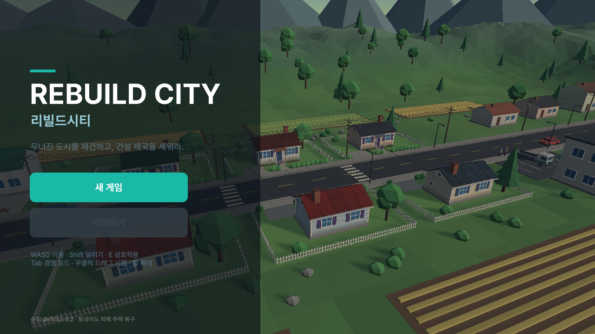
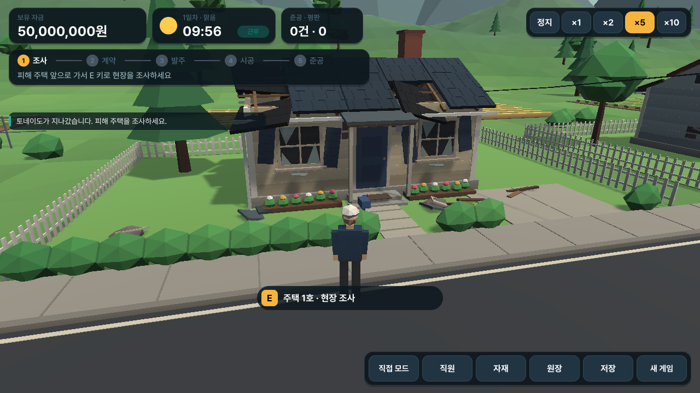
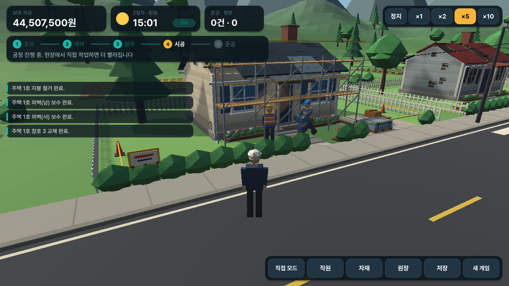
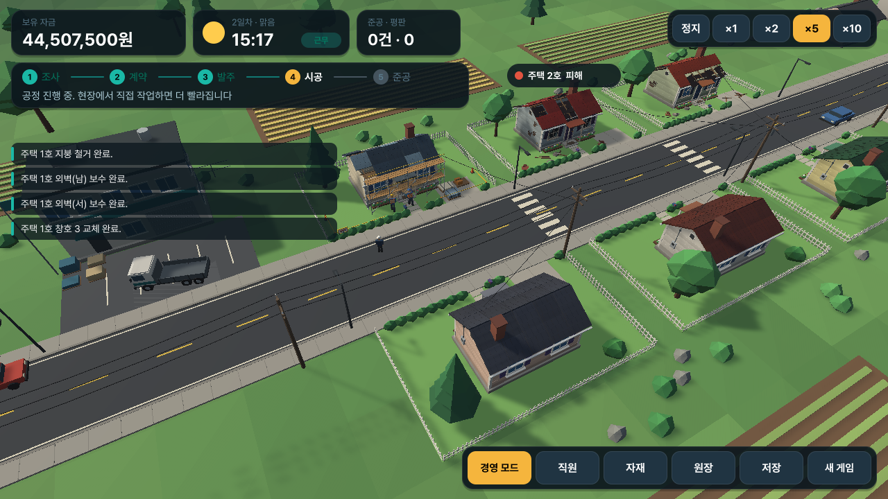
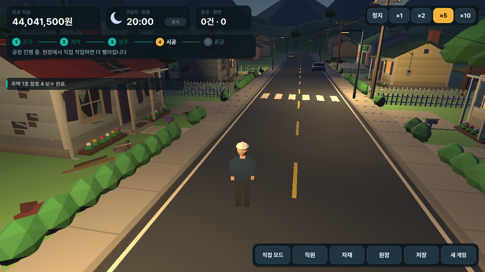

# REBUILD CITY 리빌드시티

무너진 도시를 재건하는 건설 경영 게임. Unity 6 / C# 프로젝트이며 이 브랜치(`rebuild-city`)가 전체 소스다.
기획서 2종(개발 기획서 V1.0, 상세 기술 개발서 V2.0)의 **단계 1: 수직 슬라이스**를 구현하는 중이다.



| 피해 주택 조사 | 시공 중 |
| --- | --- |
|  |  |
| 경영 모드 | 밤 |
|  |  |

위 화면은 자동 빌드가 게임을 실제로 실행해 찍은 것이다(서버 소프트웨어 렌더링, 1280×720).

## 지금 상태 (2026-11-26)

| 구분 | 상태 |
| --- | --- |
| 시뮬레이션 코어 (순수 C#, `Assets/Game/Sim`) | 구현, 자동 테스트 17개 통과 |
| Unity 화면 (`Assets/Game/Presentation`) | 빌드 성공, 리눅스 빌드를 서버에서 실행해 준공까지 완주·스크린샷 확인 |
| Android APK / Windows 빌드 | Actions에서 빌드(디버그 서명). [내려받기](https://github.com/sangjindl9-lab/lee1/releases/tag/rebuild-city-latest). **실기기 실행은 미확인** |
| 3D 모델 | 코드로 만든 저폴리 모델(Blender 원본 없음) |

자세한 구현 범위와 남은 일은 [Docs/STATUS.md](Docs/STATUS.md).

## 자동 빌드 켜기 (한 번만)

Unity는 라이선스 파일이 있어야 GitHub에서 빌드된다. 무료 Personal 라이선스로 충분하다.

1. PC에 Unity Hub를 설치하고 Unity 계정으로 로그인한다. (에디터 `6000.0.23f1`을 설치하면 PC에서 바로 열어 볼 수도 있다.)
2. Unity Hub → 설정 → Licenses → Add → **Get a free personal license**.
3. 생긴 라이선스 파일을 메모장으로 열어 전체를 복사한다.
   - Windows: `C:\ProgramData\Unity\Unity_lic.ulf`
4. GitHub 저장소 → Settings → Secrets and variables → Actions → New repository secret 으로 3개를 등록한다.
   - `UNITY_LICENSE`: 위 파일 내용 전체
   - `UNITY_EMAIL`: Unity 계정 이메일
   - `UNITY_PASSWORD`: Unity 계정 비밀번호
5. Actions 탭 → Rebuild City → 마지막 실행 → Re-run all jobs.

성공하면 실행 화면 아래 Artifacts에 `RebuildCity-Android`(APK)와 `RebuildCity-StandaloneWindows64`가 생긴다.
APK는 디버그 서명이다. 스토어 제출용 서명 빌드는 아직 만들지 않는다.

## PC에서 열어 보기

Unity Hub에서 이 폴더를 `6000.0.23f1`로 연 뒤, 메뉴 **RebuildCity → 프로젝트 준비**를 한 번 누르고 재생한다.
씬은 비어 있어도 된다. 게임이 시작할 때 코드로 마을을 만든다.

## 조작

- PC: WASD 이동, Shift 달리기, E 상호작용(조사), Tab 경영 모드, 우클릭 드래그 시점, 휠 확대, 좌클릭 부재 선택
- 모바일: 왼쪽 조이스틱 이동, 오른쪽 드래그 시점, [상호작용]·[달리기]·[+][-] 버튼, 건물을 눌러 선택

## 플레이 흐름

새 게임 → 토네이도 예보·통과 → 피해 주택 앞에서 조사 → 자재 등급·이윤을 정해 계약(선급금 30%)
→ 부족 자재 발주 → 트럭이 현장에 하역 → 작업자가 자재를 들고 가 시공(대표가 직접 작업도 가능)
→ 검측 → 준공 정산 → 저장.

## 테스트

```
dotnet run --project DomainTests -c Release
```

Unity 없이 시뮬레이션 규칙을 검증한다. 푸시할 때마다 Actions에서도 돈다.
